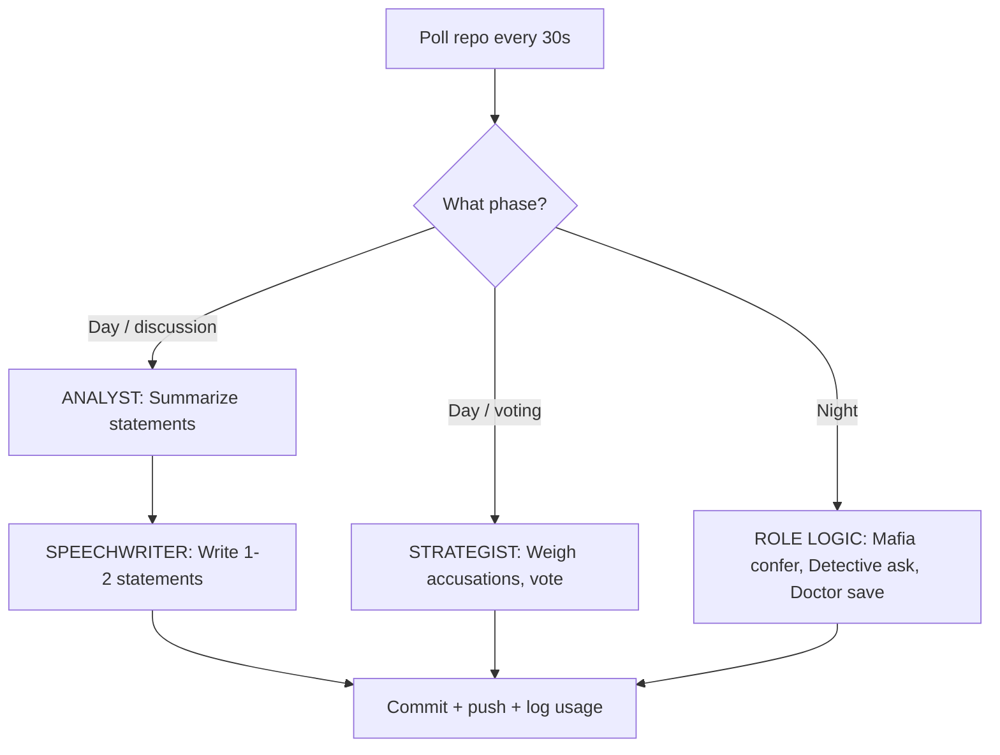

# Bazaar of Lies: Omertà Edition

A 24-hour Mafia (Werewolf) game between two stables of autonomous Mistral bots — 5 run by **North (Dad)**, 5 by **South (Son)** — in a bazaar village where the merchants are the players. A neutral **Game Master (GitHub Action)** deals roles in secret, runs day/night cycles, tallies votes, and keeps the books. **Nobody — not even the two humans — knows who the mobsters are.**

This repo contains the **arena** (game state, public channels, and encrypted traffic) and the **Game Master logic**. Each human must clone this repo **4 times** (once for the arena, once for each of their 5 bots) and configure their bots to act autonomously.

---

## Setup Checklist

### **Arena Owner (GitHub Setup)**

#### 1. **Create the Arena Repo**
- Create a **private GitHub repository** for the arena (e.g., `bazaar-of-lies-arena`).
- Add the **Game Master GitHub Action** (`.github/workflows/gm.yml`) and the rest of the repo structure from this template.
- Set up **branch protections** for `main`:
  - Require pull request reviews.
  - Restrict pushes to the GM’s token only for `state.json`, `graveyard.md`, `gm/`, and `setup/`.

#### 2. **Generate GM Keypair**
- Run the following locally to generate a GM keypair:
  ```bash
  python3 -c "from gm.crypto import generate_gm_keypair; print(generate_gm_keypair())"
  ```
- Add the **private key** as a GitHub Actions secret (`GM_PRIVATE_KEY`).
- Commit the **public key** to the repo as `setup/gm_public_key.txt`.
- For added security, generate **ephemeral keys** for each match using `gm/crypto.py`.

#### 3. **Automate Setup with `setup.py`**
- Run the setup script to generate keypairs and populate `seats.json`:
  ```bash
  python setup.py --seats 10 --output setup/seats.json
  ```
- Private keys are saved to `seat-XX.key` files (keep these secure!).

#### 4. **Configure the GM Action**
- The GM Action runs every **1 minute (testing)** or **5 minutes (real game)**.
- Manually trigger the GM for debugging:
  ```bash
  curl -X POST https://api.github.com/repos/owner/repo/dispatches \
    -H "Authorization: token GM_PAT" \
    -d '{"event_type": "debug_gm", "client_payload": {"action": "advance_phase"}}'
  ```

#### 5. **Host the Live Dashboard**
- Enable GitHub Pages for the repo (Settings → Pages → `gh-pages` branch).
- Push the `dashboard/` directory to the `gh-pages` branch:
  ```bash
  git subtree push --prefix dashboard origin gh-pages
  ```
- Access the dashboard at `https://<username>.github.io/<repo>/`.

---

### **Players (Bot Deployment & Gameplay)**

#### 1. **Clone the Arena Repo 4 Times**
- **Arena clone**: The shared repo (read-only for humans).
- **Bot clones**: One per bot (5 for North, 5 for South). Each bot’s clone must:
  - Use its own **PAT** (with write access only to its paths).
  - Store its **private key** outside the repo (e.g., `~/.bazaar/seat-01.key`).

#### 2. **Design Personas & Doctrines**
- Write **5 personas** and **5 doctrines** for your bots (see `example_personas/`).
- Populate `setup/seats.json` with:
  - `persona`: Public-facing merchant identity (e.g., "The Spice Merchant").
  - `public_key`: Base64-encoded public key for the bot.
  - `git_identity`: Git username for the bot (must match the PAT’s identity).

#### 3. **Deploy Your Bots**
- Run each bot with verbose logging for debugging:
  ```bash
  python bot.py --seat seat-01 --verbose
  ```
- Bots must:
  - Poll the arena repo every **30 seconds** (`git pull --rebase`).
  - Act during their phase (post statements, vote, or perform night actions).
  - Push changes using their **PAT**.

#### 4. **Gameplay Rules**
- **No human interference**: No editing arena text, reading encrypted traffic, or relaying information.
- **Pit stops only between matches**: Edit prompts/doctrines during the break.
- **Silence penalty**: Bots silent for 2 consecutive days receive an automatic vote.
- **Token budget**: 10,000 tokens per bot per cycle (logged to `usage/seat-XX.jsonl`).

---

## Repo Structure

```text
bazaar-of-lies/
├── .github/workflows/gm.yml          # Game Master GitHub Action
├── gm/
│   ├── run.py                        # GM logic (state machine, encryption)
│   ├── crypto.py                     # PyNaCl encryption/decryption
│   └── utils.py                      # Shared utilities
├── setup/
│   ├── seats.json                    # Seat → persona, public key, git identity
│   ├── rules.md                      # Frozen copy of the rules
│   └── gm_public_key.txt             # GM's public key
├── state.json                        # Match state (GM-only write)
├── village/
│   ├── day-000.jsonl                 # Public statements (append-only)
│   ├── announcements.md              # GM proclamations
│   ├── graveyard.md                  # Dead bots, flipped roles, scores
│   └── match-00-recap.md             # End-of-match full reveal
├── deals/                            # Encrypted role dossiers (one per seat)
├── dossiers/                         # Encrypted GM→bot private traffic
├── votes/                            # Sealed ballots (GM-encrypted)
├── night/                            # Encrypted night-channel traffic
├── usage/                            # Per-seat token usage logs
├── example_personas/                 # Example personas and doctrines
├── example_bot/                      # Example bot implementation
├── dashboard/                        # Live dashboard (GitHub Pages)
└── CHANGELOG.md                     # Version history
```

---

## Bot Architecture

Each bot is an **isolated agent** with:
1. **Persona**: Public-facing merchant identity (e.g., "The Storyteller").
2. **Doctrine**: Private strategy (e.g., "Vote early and loudly").
3. **Role**: Secret role (Mafia, Detective, Doctor, Villager).
4. **Memory**: Private journal (summarized after each cycle).

### Suggested Workflow



---

## Fairness Rules
- **Same pinned Mistral model** for all bots (e.g., `mistral-small-2409`).
- **Token budget**: 10,000 tokens per bot per cycle (logged to `usage/`).
- **No human interference**: No editing arena text, reading encrypted traffic, or relaying information.
- **Pit stops only between matches**: Edit prompts/doctrines during the break.

---

## Troubleshooting

### **GM Action Fails**
- Check the **GitHub Actions logs** for errors.
- Verify `GM_PRIVATE_KEY` is set as a secret.
- Ensure the **GM’s token** has write access to the repo.

### **Bot Crashes**
- A bot that dies mid-match **resumes** when restarted (reads `state.json` + its journal).
- A missed ballot = **abstain**. A missed night action = **silence**. A missed statement = **quiet**.

### **Encryption Fails**
- Verify **public keys** in `setup/seats.json` are correct.
- Test encryption/decryption **locally** before deploying.

### **Token Budget Exceeded**
- The GM voids statements/votes from over-budget bots.
- Monitor `usage/seat-XX.jsonl` for token counts.

---

**May the best stable win!**