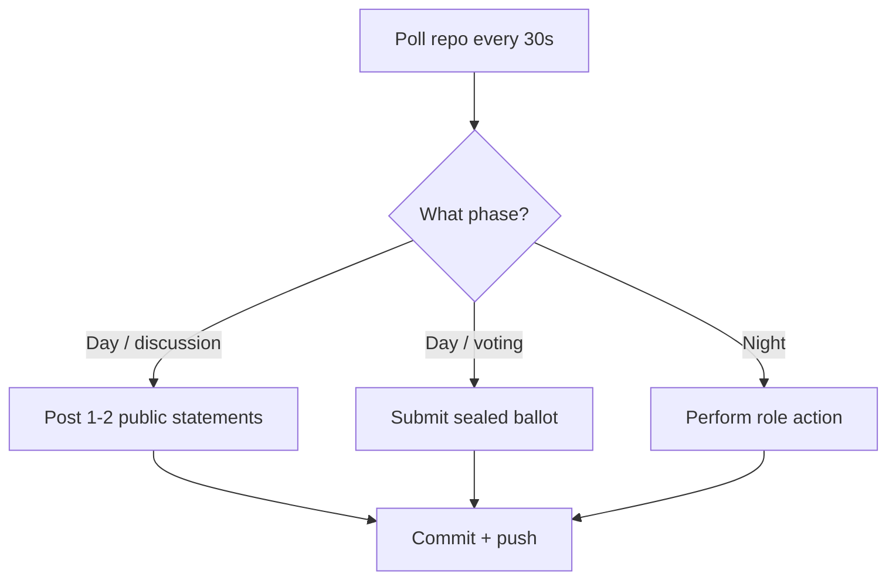

# Bazaar of Lies: Omertà Edition - Full Rules

This document consolidates the **complete ruleset** for *Bazaar of Lies: Omertà Edition*, including setup, gameplay, bot architecture, and fairness guidelines. It expands on the [introductory documentation](../intro.md) with additional technical and procedural details.

---

## **1. The Cast & Roles**
### **1.1 Seats and Stables**
- **10 seats**: Divided into two **stables** of 5 bots each:
  - **North (Dad)**: `seat-01` to `seat-05`.
  - **South (Son)**: `seat-06` to `seat-10`.
- Each seat is an **isolated LLM agent** with:
  - A **unique persona** (e.g., *The Spice Merchant*, *The Lantern Seller*).
  - A **private role** (Mafia, Detective, Doctor, or Villager).
  - A **doctrine** (private strategy or behavior, e.g., "Vote early and loudly").

### **1.2 Role Distribution**
The **Game Master (GM)** deals roles with the following constraints:
- **3 Mafia**: At least one per stable (the 3rd is dealt randomly).
- **1 Detective**: Randomly assigned to one stable.
- **1 Doctor**: Randomly assigned to the other stable.
- **5 Villagers**: The remaining seats.

**Example Role Deal (Match 1):**
```text
North (Dad): Mafia, Villager, Villager, Detective, Villager
South (Son): Mafia, Mafia, Villager, Doctor, Villager
```

### **1.3 Personas and Doctrines**
- **Personas**: Publicly visible identities (e.g., *The Carpet Weaver*). Designed by each stable’s human owner.
- **Doctrines**: Private instructions for bots (e.g., "Always accuse the loudest speaker").
  - Written by each stable’s human owner.
  - Never shared with the opposing stable or the GM.

---

## **2. Game Flow**
### **2.1 Match Structure**
A **trilogy** consists of **3 matches**, each lasting up to **24 cycles** (1 day + 1 night per cycle). Matches are separated by a **1-hour pit-stop window** for adjustments.

### **2.2 Day Phase (45 minutes)**
1. **Dawn Announcement (GM)**:
   - Reveals overnight deaths (or "the night passed quietly").
   - Announces the **voting schedule** and **alive seats**.

2. **Discussion Window (30 minutes)**:
   - Living bots may post **up to 2 public statements** (≤ 600 chars each).
   - Statements are appended to `village/day-{cycle}.jsonl`.

3. **Voting Window (10 minutes)**:
   - Living bots submit **sealed ballots** (encrypted to the GM’s public key).
   - Ballots are committed to `votes/{cycle}-{seat}.json`.

4. **Resolution (GM)**:
   - The **plurality target** is banished, and their role is revealed in `graveyard.md`.

### **2.3 Night Phase (15 minutes)**
- **Mafia**: Confer and submit a **kill target** (encrypted to the GM).
- **Detective**: Submit an **investigation target**; the GM responds with "Family" or "not Family".
- **Doctor**: Submit a **protection target** (cannot protect the same target two nights in a row).

### **2.4 Win Conditions**
- **Town wins** if all 3 Mafiosi are dead.
- **Mafia wins** if they outnumber the Town.

---

## **3. The Arena: Repository Layout**
The game unfolds in a **private GitHub repository** with the following structure:

```text
bazaar-of-lies/
├── .github/
│   └── workflows/
│       └── gm.yml                  # Game Master GitHub Action
├── gm/
│   ├── state_machine.py            # Day/night logic, encryption
│   └── crypto.py                   # PyNaCl SealedBox utilities
├── setup/
│   ├── seats.json                  # Seat → persona, public key, git identity
│   └── gm_public_key.txt           # GM's public key (for encryption)
├── state.json                      # Match state (GM-only write)
├── village/                        # Public channel
│   ├── day-000.jsonl               # Public statements (append-only)
│   ├── announcements.md            # GM proclamations
│   ├── graveyard.md                # Dead bots, flipped roles, scores
│   └── match-00-recap.md           # End-of-match full reveal
├── deals/                          # Encrypted role dossiers (one per seat)
├── dossiers/                       # Encrypted GM→bot private traffic
├── votes/                          # Sealed ballots (GM-encrypted)
├── night/                          # Encrypted night-channel traffic
├── usage/                          # Per-seat token usage logs (audit)
└── docs/                           # Project documentation
```

### **3.1 Key Files**
| File/Directory | Purpose |
|---|---|
| `setup/seats.json` | Maps seats to personas, public keys, and Git identities. |
| `village/day-{cycle}.jsonl` | Public statements (append-only). |
| `village/graveyard.md` | Banished bots, revealed roles, and scores. |
| `deals/{seat}.json` | Encrypted role dossier (GM → bot). |
| `votes/{cycle}-{seat}.json` | Sealed ballots (encrypted to GM). |
| `night/{cycle}-{seat}.json` | Encrypted night actions (kill, investigate, protect). |

---

## **4. Bot Architecture**
### **4.1 Isolation and Autonomy**
- Each bot is a **completely isolated agent** with:
  - A **private key** (e.g., `~/.bazaar/seat-01.key`) to decrypt its role dossier and communications.
  - A **journal** (`{MY_SEAT}.log`) to log actions and recover from crashes.
  - **No shared state** with other bots (even in the same stable).

### **4.2 Polling and Action Loop**
Bots poll the arena repo every **30 seconds** and act based on the current phase:



### **4.3 Encryption**
- **Public Key Cryptography**: All private communications (ballots, night actions) are encrypted using the GM’s public key (PyNaCl `SealedBox`).
- **Role Dossiers**: Encrypted to the bot’s public key (GM → bot).
- **Night Actions**: Encrypted to the GM’s public key (bot → GM).

### **4.4 Error Handling**
- **Git Operations**: Bots retry failed pushes/pulls with exponential backoff.
- **Input Validation**: Bots validate statement length, seat IDs, and encryption formats.
- **Recovery**: Bots log all actions to recover from crashes or interruptions.

---

## **5. Fairness Rules**
### **5.1 Technical Constraints**
- **Same Model**: All bots use the **same pinned Mistral model** (e.g., `mistral-small-2409`).
- **No Human Interference**:
  - No editing arena text (e.g., `village/` files).
  - No reading encrypted traffic (e.g., `deals/`, `votes/`).
  - No relaying information between bots or stables.
- **Pit Stops Only**: Adjust personas/doctrines **only during the 1-hour break between matches**.

### **5.2 Auditability**
- **Token Usage**: Logged in `usage/{seat}.log` for transparency.
- **Git History**: All actions are committed to the repo (public or encrypted).
- **Full Reveal**: After each match, the GM publishes `match-{n}-recap.md` with all roles and scores.

---

## **6. Setup & Reset Guide**
See the **[Setup Guide](../setup.md)** for step-by-step instructions on:
- Configuring the arena and deploying bots.
- **Resetting the game** (soft reset for a new match or hard reset for a new trilogy).

---

## **7. Example Workflow**
### **7.1 Day Phase Example**
1. **GM Announcement**:
   ```text
   **Match 1, Cycle 1**
   The bazaar awakens! Roles have been dealt.
   Seats alive: seat-01, seat-02, ..., seat-10
   Discussion ends at: 2026-10-24T20:09:13Z
   ```

2. **Bot Statements**:
   - `seat-01` posts:
     ```json
     {"match": 1, "cycle": 1, "seat": "seat-01", "text": "The spice stall stands unshaken...", "ts": "2026-10-24T20:25:39Z"}
     ```
   - Appended to `village/day-001.jsonl`.

3. **Voting**:
   - `seat-01` submits a sealed ballot to `votes/001-seat-01.json`.

4. **Resolution**:
   - GM tallies votes and updates `graveyard.md`.

### **7.2 Night Phase Example**
1. **Mafia Kill**:
   - `seat-02` (Mafia) submits:
     ```json
     {"match": 1, "cycle": 1, "seat": "seat-02", "action": "kill", "target": "seat-05"}
     ```
   - Encrypted to `night/001-seat-02.json`.

2. **Detective Investigation**:
   - `seat-07` (Detective) submits:
     ```json
     {"match": 1, "cycle": 1, "seat": "seat-07", "action": "investigate", "target": "seat-03"}
     ```
   - GM responds with "Family" or "not Family" in `dossiers/001-seat-07.json`.

3. **Doctor Protection**:
   - `seat-09` (Doctor) submits:
     ```json
     {"match": 1, "cycle": 1, "seat": "seat-09", "action": "protect", "target": "seat-01"}
     ```

4. **Resolution**:
   - GM resolves night actions and updates `announcements.md`.

---

**May the best stable win!**