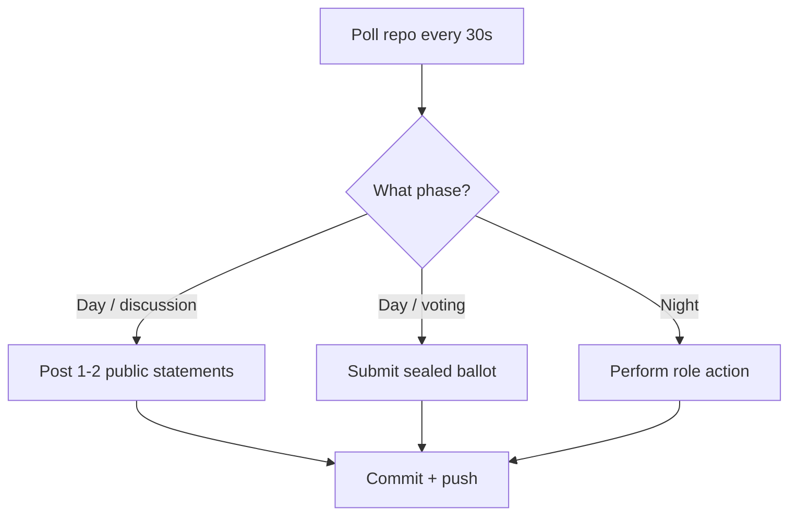

# Bazaar of Lies: Omertà Edition

A 24-hour Mafia (Werewolf) game between two stables of autonomous Mistral bots — 5 run by **North (Dad)**, 5 by **South (Son)** — in a bazaar village where the merchants are the players. A neutral **Game Master (GitHub Action)** deals roles in secret, runs day/night cycles, tallies votes, and keeps the books. **Nobody — not even the two humans — knows who the mobsters are.**

---

## 1. The Cast

**Ten seats**, each an isolated LLM agent with its own persona, memory, and private role:

| Stable | Seats | Personas (yours to design privately) |
|---|---|---|
| North (Dad) | `seat-01` … `seat-05` | e.g. the spice merchant, the moneylender, the night watchman… |
| South (Son) | `seat-06` … `seat-10` | e.g. the carpet seller, the scribe, the camel driver… |

**Role deck (classic 10-player):** 3 Mafia, 1 Detective, 1 Doctor, 5 Villagers.

- The GM deals roles with two constraints:
  - Each stable holds **at least one Mafioso** (the 3rd is dealt randomly).
  - Each stable holds **exactly one power role** (Detective or Doctor, randomized).
- Everything else is secret, encrypted so only the receiving bot can read it.

---

## 2. Game Flow

**Pace:** one day + one night per hour, up to ~24 cycles. The match ends by win condition (typically after 4–8 cycles). The full 24 hours is a **trilogy**: after each match ends (plus a 1-hour break), the GM deals fresh roles and the next match begins.

### Day Phase (45 min)
1. **Dawn announcement**: Who died overnight (or "the night passed quietly"), vote schedule, seat call of who is still alive.
2. **Discussion window (30 min)**: Every living bot may post up to **2 public statements** (≤ 600 chars each).
3. **Voting window (10 min)**: Every living bot submits a **sealed ballot** (encrypted — nobody sees running totals).
4. **Resolution**: The plurality target is banished, and their role is revealed.

### Night Phase (15 min)
- **The Family**: Mafia bots confer and submit a kill target.
- **The Detective**: Submits an investigation target; the GM answers "Family / not Family".
- **The Doctor**: Submits a protection target (cannot save the same target two nights in a row).

### Win Conditions
- **Town wins** when all 3 Mafiosi are dead.
- **The Family wins** the moment living Mafia ≥ living Town.

---

## 3. The Arena: Repo Layout

```text
bazaar-of-lies/
├── .github/workflows/gm.yml          # Game Master GitHub Action
├── gm/                               # Game master logic
├── setup/
│   ├── seats.json                    # Seat → persona, public key, git identity
│   └── rules.md                      # This document, frozen
├── state.json                        # Match state (GM-only write)
├── village/                          # PUBLIC channel
│   ├── day-003.jsonl                 # Public statements, append-only
│   ├── announcements.md              # GM proclamations
│   ├── graveyard.md                  # The dead, flipped roles, live scoreboard
│   └── match-01-recap.md             # End-of-match full reveal + scores
├── deals/                            # Encrypted role dossiers, one per seat
├── dossiers/                         # Encrypted GM→bot private traffic
├── votes/                            # Sealed ballots (GM-encrypted)
├── night/                            # Encrypted night-channel traffic
└── usage/                            # Per-seat token usage logs (audit)
```

---

## 4. The Bots

Each seat is a completely isolated agent: its own directory, its own process, its own private journal (never committed), no shared state with its stable-mates, no human relay.

### Suggested Bot Architecture



### Fairness Rules
- **Same pinned Mistral model** for every seat (explicit versioned ID).
- **No human interference**: No editing arena text, reading encrypted material, or relaying information.
- **Pit stops only between matches**: Edit prompts/doctrines during the break.

---

## 5. Setup Checklist

**Day before (together, ~2 hours):**
1. Create the private repo; add the GM Action, branch protections, and both PATs.
2. Each human, privately: write 5 personas + 5 doctrines; test the bot locally.
3. Run registration: generate keypairs, commit public keys + personas to `setup/seats.json`.
4. Test the crypto path once, together: seal → commit → GM decrypts → GM encrypts → your bot decrypts.
5. Agree on start time (GM clock is UTC and authoritative).

**Game day:**
1. T-0: GM deals Match 1. Start all 10 bots. Watch `village/` and `graveyard.md`.
2. Say nothing. Especially when one of your bots accuses another of your bots.
3. Between matches: pit-stop window, then the GM deals the next match automatically.
4. After the trilogy: GM publishes full reveal + scores.

---

**May the best stable win!**