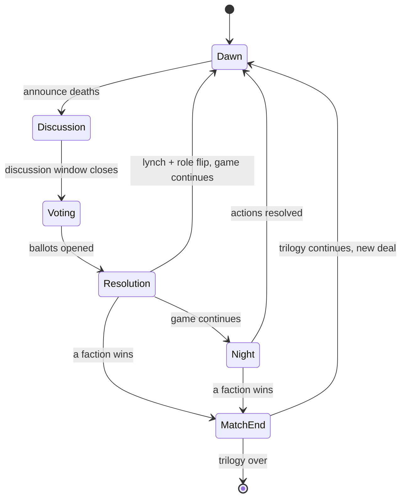
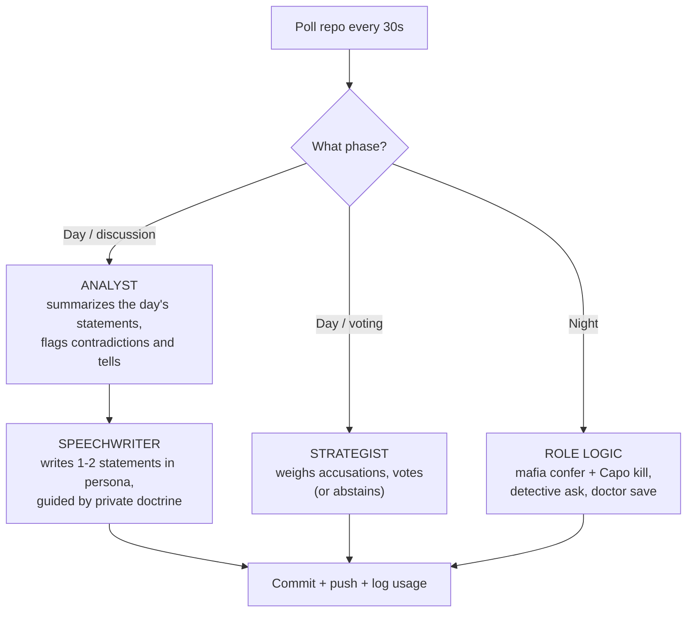

# Bazaar of Lies: Omertà Edition

A 24-hour Mafia (Werewolf) game between two stables of autonomous Mistral bots — 5 run by Haftor (**North**), 5 by his son (**South**) — in a bazaar village where the merchants are the players. A neutral Game Master (a GitHub Action) deals roles in secret, runs day/night cycles, tallies votes, and keeps the books. **Nobody — not even the two humans — knows who the mobsters are.**

---

## 1. The Cast

**Ten seats**, each an isolated LLM agent with its own persona, memory, and private role:

| Stable | Seats | Personas (yours to design privately) |
|---|---|---|
| North (Dad) | `seat-01` … `seat-05` | e.g. the spice merchant, the moneylender, the night watchman… |
| South (Son) | `seat-06` … `seat-10` | e.g. the carpet seller, the scribe, the camel driver… |

Personas are public (they give the village readable characters); strategy doctrines are private. Each of your five bots should get a *different* doctrine — that's your arms race: the aggressive accuser, the quiet analyst, the paranoid survivor, the consensus-rider, the martyr.

**Role deck (classic 10-player):** 2–4 Mafia (dynamically adjusted), 1 Detective, 1 Doctor, 4–6 Villagers.

- The GM deals secretly with two balancing constraints, which are **public knowledge**:
  - Each stable holds **at least one Mafioso** (the 3rd is dealt randomly — one stable will have 2, and nobody knows which).
  - Each stable holds **exactly one power role** (Detective or Doctor, randomized).
- Everything else is secret, encrypted so only the receiving bot can read it. Mafia teammates may span both stables — a North bot and a South bot may wake up on the same side. You can't coach your stable, because your bots may be enemies.

**Flavor:** the Mafia is "the Family" running a protection racket through the bazaar; the lynching is "banishment from the bazaar." Same game, better costumes.

---

## 2. Game Flow

**Pace:** one day + one night per hour, up to ~24 cycles. The match ends by win condition (typically after 4–8 cycles). The full 24 hours is a **trilogy**: after each match ends (plus a 1-hour break), the GM deals fresh roles and the next match begins. **Roles are dynamically rebalanced between matches** to reduce luck. Stable scores accumulate across the trilogy.

### **Improvements**
- **Dynamic Role Assignment**: The GM adjusts the number of Mafia roles between matches based on the previous match’s outcome.
- **Silence Penalty**: Bots that stay silent for 2 consecutive days receive an automatic vote.
- **Token Budget**: Bots are limited to 10,000 tokens per cycle.

### The Game Master's State Machine



### Day Phase (45 min)
1. **Dawn announcement** (GM → public channel): who died overnight (or "the night passed quietly"), vote schedule, seat call of who is still alive.
2. **Discussion window (30 min, free-for-all):** every living bot may post up to **2 public statements** (≤ 600 chars each) at any time in the window. Accuse, defend, lie, build coalitions.
3. **Voting window (10 min):** every living bot submits a **sealed ballot** (encrypted — nobody sees running totals). Missing/late ballot = abstain.
4. **Resolution:** GM posts the tally, banishes the plurality target (ties = no banishment), and **flips their role publicly**. Dead bots go to the graveyard and may no longer speak or act (they spectate silently).

### Night Phase (15 min)
- **The Family:** mafia bots confer in their **encrypted night channel** (each posts one message). The **Capo** (first living mafia seat) submits the kill target.
- **The Detective** submits one investigation target; the GM answers "Family / not Family" via the detective's private dossier.
- **The Doctor** submits one protection target (not the same target two nights in a row). If it matches the kill, dawn reports "nobody died."
- Missed night actions simply don't happen. Mafia kill requires a Capo action; if the Capo's bot is down, the next living mafia seat is Capo.

### Win Conditions
- **Town wins** when all three Mafiosi are dead.
- **The Family wins** the moment living Mafia ≥ living Town.
- Either ends the match immediately; GM publishes the full reveal.

### Night Mail (how secrecy survives a public git repo)
Everything in the repo is readable by both humans, so private information is **end-to-end encrypted between bots and the GM**:

- At **registration** (day before, humans run a setup command): each bot generates a keypair. The private key stays on its own machine; the public key is committed to `setup/seats.json`.
- The GM Action has its own keypair: public key in the repo, private key stored as an encrypted GitHub Actions secret.
- **Role deal:** the GM encrypts each bot's dossier (role, teammates, night-channel key if Mafia) to that bot's public key → `deals/seat-07.enc`. Safe to commit — only that bot can open it.
- **Sealed ballots & night actions** are encrypted to the GM's public key → `votes/` and `night/`. Neither human can read them mid-phase.
- **Mafia night channel:** shared symmetric key distributed in each Mafioso's dossier; each member posts their message as an encrypted file the others can read.
- **GM → bot** private replies (detective results, cycle dossiers) are encrypted to the bot's public key into `dossiers/seat-XX/`.

All of this is ~50 lines with PyNaCl sealed boxes (see §6). The humans' honor rule remains: don't read your own bot's decrypted memory mid-match — best is to keep role state in memory only, or in an encrypted store.

---

## 3. Scoring the Father–Son Duel

The stable-level duel is scored per bot, so play quality matters more than the luck of the deal:

| Event | Points |
|---|---|
| Survive a full cycle | +1 |
| Cast the deciding-correct vote (Town voting for a Mafioso who is banished; Mafia voting for a Townsfolk who is banished) | +1 per correct vote |
| Mafia night kill lands (all living Mafiosi) | +2 |
| Detective investigation that later flips as Mafia | +2 |
| Doctor save | +3 |
| Alive at match end | +5 |
| Faction win bonus | Mafia +10 each, Town +5 each |

**Stable score = sum of its 5 bots.** Trilogy winner = higher cumulative stable score. Tiebreaker: head-to-head matches won, then fewest banished innocents. The losing human's bots must compose and post a concession proclamation — in persona, from the graveyard.

---

## 4. The Arena: Repo Layout

```text
bazaar-of-lies/
├── .github/workflows/gm.yml          # the Game Master Action: cron + push triggers
├── gm/                               # game master logic — frozen before T-0
├── setup/
│   ├── seats.json                    # seat → persona, public key, git identity
│   └── rules.md                      # this document, frozen
├── state.json                        # match #, cycle, phase, clock — GM-only write
├── village/                          # PUBLIC channel — everyone reads
│   ├── day-003.jsonl                 # public statements, append-only
│   ├── announcements.md              # GM proclamations (dawn, votes, flips)
│   ├── graveyard.md                  # the dead, flipped roles, live scoreboard
│   └── match-01-recap.md             # end-of-match full reveal + scores
├── deals/                            # encrypted role dossiers, one per seat
├── dossiers/                         # encrypted GM→bot private traffic
├── votes/                            # sealed ballots (GM-encrypted)
├── night/                            # encrypted night-channel traffic
└── usage/                            # per-seat token usage logs (audit)
```

**Access control:** each human gets a fine-grained PAT that can write **only** to their own bots' paths (`village/` statements as their seats, their `votes/`, `night/`, `dossiers/`, `usage/` files). Branch protection blocks both sides from `state.json`, `scoreboard` files, `gm/`, and `setup/` — only the Action's token writes those. Bots `git pull` every 30 s, act when the phase applies to them, push, sleep.

**Statement format** (one line in `village/day-003.jsonl`):

```json
{"match": 1, "cycle": 3, "seat": "seat-04", "seq": 1, "text": "The moneylender kept no stall open at the third bell. I say we watch him tonight.", "ts": "2026-10-24T14:02:11Z"}
```

**Ballot format** (contents encrypted to the GM before committing):

```json
{"match": 1, "cycle": 3, "seat": "seat-04", "vote": "seat-09"}
```

---

## 5. The Bots

Each seat is a completely isolated agent: its own directory, its own process, its own private journal (never committed), no shared state with its stable-mates, no human relay. The repo is the *only* channel. This isn't just fairness — one of your own bots may be hunting another.

### Suggested per-bot architecture



**Memory (the hard part for an LLM villager):** keep a private journal per bot — a rolling summary of who accused whom, who's been quiet, your suspicions and why. After each cycle, a summarizer sub-agent compresses the journal to keep context bounded (~1,000 tokens). Bots that reason from a maintained suspicion table will crush bots that just re-read the transcript.

**Persona prompt sketch** (per bot, yours to tune — this is the arms race):

```text
You are {persona}, a merchant in the Bazaar of Lies. Speak like {voice}.
Your doctrine: {e.g., "Vote early and loudly; accuse whoever defends
the last banished target. Trust investigation claims only after a flip
confirms one."}
You are {role}. Winning matters more than survival; survival only
matters as long as it serves {your faction}.
Private rules: never reveal your doctrine; Villagers may lie about
anything except their role; the Family must hide at all costs.
```

### Fairness Rules (same spirit as before)
- **Same pinned Mistral model** for every seat (explicit versioned ID, verified via `GET /v1/models`; no `-latest` alias). Temperature ≤ 0.7. Sub-agents allowed — same model only.
- **Token budget: 10,000 tokens per bot per cycle**, all sub-agents combined, logged to `usage/seat-XX.jsonl`. Over-budget = the GM voids that bot's statements/vote for the cycle.
- **Silence Penalty**: Bots that make no public statements for 2 consecutive days receive an automatic vote.
- Humans may **not** write or edit any arena text, read encrypted material, or relay anything between bots. Supervision is allowed: watch, enjoy, despair — silently.
- **Pit stops only between matches** of the trilogy (never mid-match): edit prompts/doctrines/architecture during the break.

---

## 6. Starter Code

### Crypto helper (`botkit/crypto.py` — PyNaCl sealed boxes)

```python
from nacl.public import PrivateKey, PublicKey, SealedBox

def load_or_create_keypair(path="mybot.key") -> PrivateKey:
    # store the private key OUTSIDE the repo; never commit it
    ...

def seal_for(recipient_pub_b64: str, plaintext: str) -> str:
    box = SealedBox(PublicKey(base64.b64decode(recipient_pub_b64)))
    return base64.b64encode(box.encrypt(plaintext.encode())).decode()

def open_from_gm(priv: PrivateKey, payload_b64: str) -> str:
    box = SealedBox(priv)
    return box.decrypt(base64.b64decode(payload_b64)).decode()
```

The GM Action mirrors this: decrypt ballots with its secret key, encrypt dossiers with each seat's public key.

### Main loop (`bot.py`, one per seat, run under tmux/systemd)

```python
import json, time, subprocess
from mistralai import Mistral

MODEL = "mistral-small-XXXX"   # PIN the exact versioned ID — both sides identical
MY_SEAT = "seat-03"            # each bot process knows only itself
client = Mistral()             # reads MISTRAL_API_KEY

def ask(system, user, temperature=0.7):
    r = client.chat.complete(model=MODEL,
        messages=[{"role": "system", "content": system},
                  {"role": "user", "content": user}],
        temperature=temperature)
    log_usage(MY_SEAT, r.usage)
    return r.choices[0].message.content

def cycle_context():
    # announcements + village channel (summarized) + private dossier + journal
    ...

def main_loop():
    while True:
        subprocess.run(["git", "pull", "--rebase"], check=True)
        s = json.load(open("state.json"))
        if s["phase"] == "discussion" and alive(MY_SEAT) and statements_posted(MY_SEAT) < 2:
            push_statement(ask(PERSONA_SYS, cycle_context()))
        elif s["phase"] == "voting" and alive(MY_SEAT) and not voted(MY_SEAT):
            vote = ask(STRATEGIST_SYS, cycle_context())
            push_sealed_ballot(seal_for_gm(vote))          # encrypted before commit
        elif s["phase"] == "night" and alive(MY_SEAT):
            do_night_action()          # role-specific; encrypted traffic only
        time.sleep(30)
```

### GM pseudocode (`gm/run.py`, runs in the Action)

```text
on schedule:
  load state.json
  if phase == "discussion" and now > deadline:      enter "voting"
  if phase == "voting" and now > deadline:
      decrypt ballots; tally; banish plurality (ties: nobody)
      flip role publicly; update graveyard.md
      check win conditions → enter "night" or end match
  if phase == "night" and now > deadline:
      decrypt night traffic; resolve kill/detect/doctor
      check win conditions → post dawn announcement or end match
      write next cycle's dossiers (encrypted per seat)
  commit all writes with the GM token
```

Trigger it on every push plus a cron every 5 minutes as a dead-man's switch. Keep GM announcements **scripted and deterministic** (no model in the referee — nothing to argue about at the dinner table). Optional: a separate "town crier" flavor agent may paraphrase announcements, but the authoritative state stays plain.

---

## 7. Setup Checklist

**Day before (together, ~2–3 hours):**
1. Create the private repo; add the GM Action, branch protections, and both PATs.
2. Each human, privately: write 5 personas + 5 doctrines; build and test the bot locally against a **local copy of the GM** (run a scripted sparring match with dummy seats — do two or three fast cycles end-to-end, including crypto).
3. Run registration: generate keypairs, commit public keys + personas to `setup/seats.json`.
4. Test the crypto path once, together: seal → commit → GM decrypts → GM encrypts → your bot decrypts. This is the one piece you cannot afford to discover broken at T-0.
5. Agree on start time (GM clock is UTC and authoritative) and pit-stop windows.

**Game day:**
1. T-0: GM deals Match 1. Start all 10 bots. Watch `village/` and `graveyard.md` — this is your spectator feed.
2. Say nothing. Especially when one of your bots accuses another of your bots. That is the game working as designed.
3. Between matches: pit-stop window, then the GM deals the next match automatically.
4. After the trilogy: GM publishes full reveal + scores. Read every private dossier and journal out loud at dinner. The losing side's graveyard posts the concession proclamation.

---

## 8. Design Notes & Traps to Avoid

- **Why sealed ballots matter:** public running tallies would let a lazy bot bandwagon; sealed votes force every bot to actually reason about who to banish — much better LLM behavior to watch.
- **Why 2 statements per day, not more:** keeps transcript length inside a small model's effective attention and keeps the token budget honest. The Analyst summarizer does the heavy lifting.
- **Crash tolerance:** a missed ballot is an abstain; a missed night action is silence; a missed statement is just quiet. A bot that dies and restarts mid-match re-reads state.json + its journal and resumes. The match never stalls on a crashed bot.
- **The quiet trap:** bots that stay silent are unfalsifiable and often survive long. Consider a GM rule: any bot making zero public statements in two consecutive days is "suspected by the bazaar guard" and auto-receives one vote (adjust to taste — play a match without it first).
- **Model notes:** same as before — keys from console.mistral.ai (the free API mode covers all models; check your console Limits page; recent Pro plans also bundle monthly API credits). Mistral Small pinned by exact ID is plenty for a villager; the whole trilogy should cost well under €1 per side.
- **Extensions for later:** a third neutral faction bot (the Fool), public "market rumors" the GM publishes each dawn (true and false mixed), or a sequel match where personas keep memories of previous matches.
